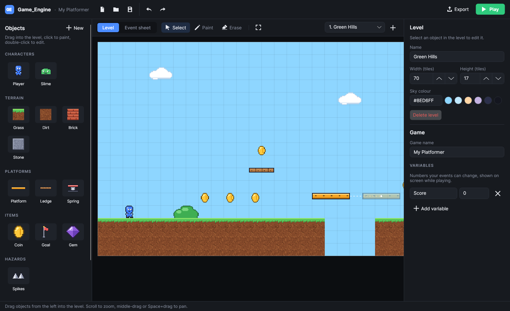
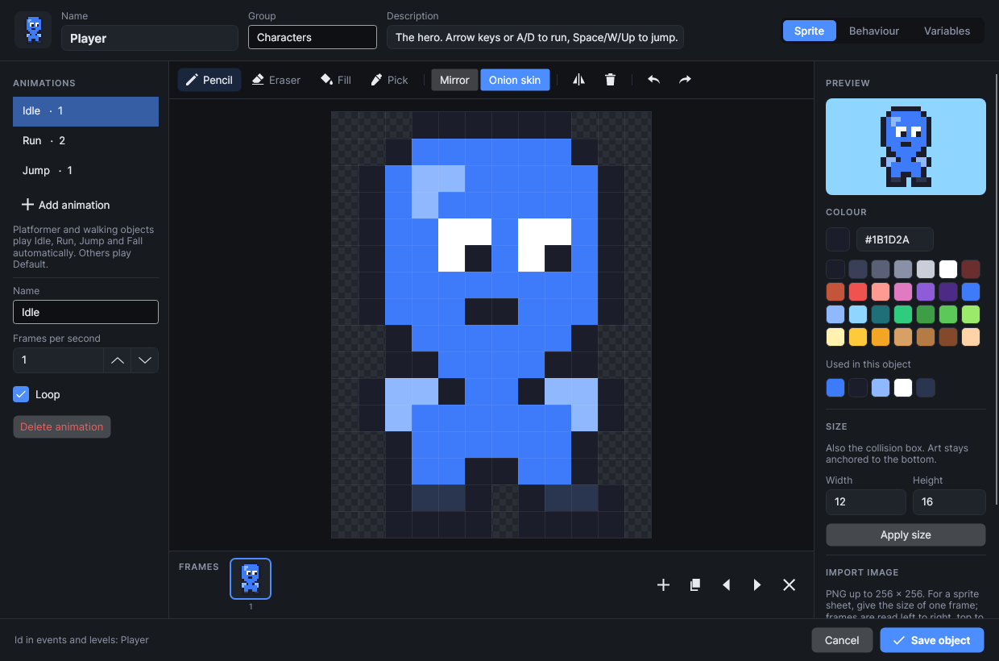
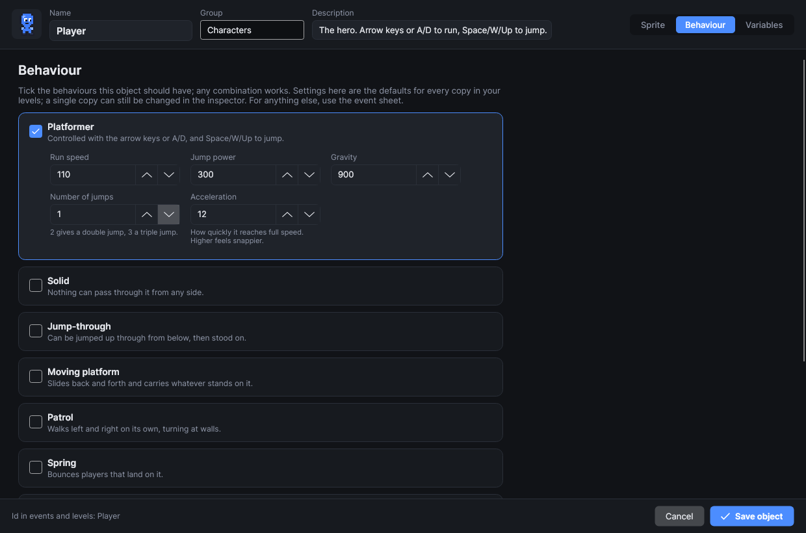
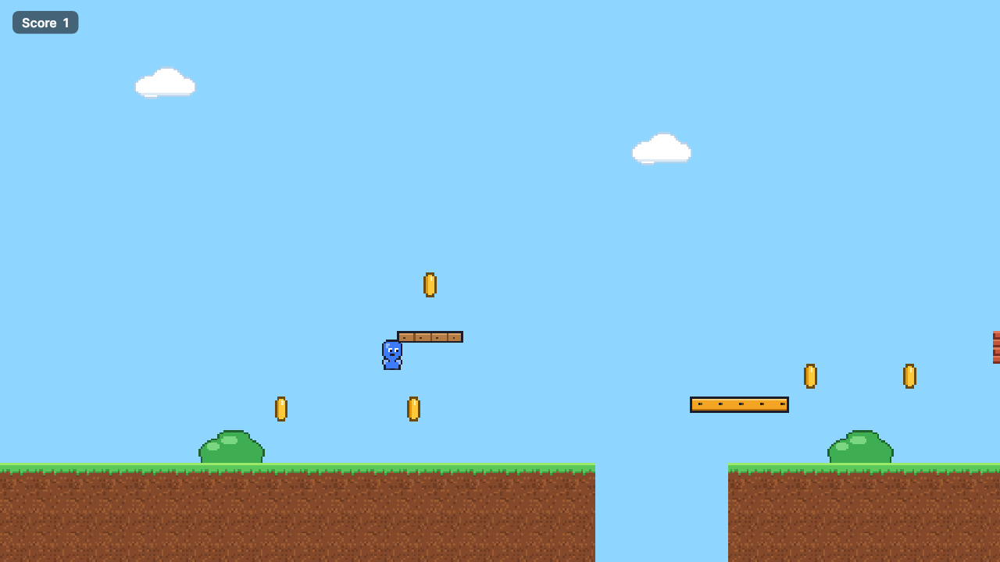
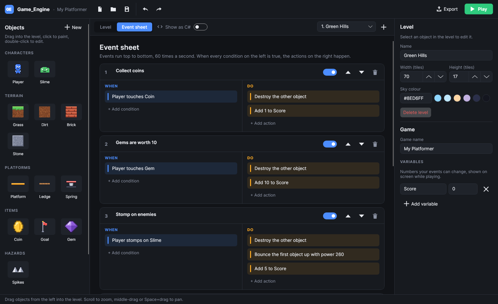

# Game_Engine

A desktop editor for making 2D platformer games, written in C#.

Drag premade objects (player, ground, moving platforms, coins, enemies, springs, spikes, a goal flag) into a level, or draw your own. Wire up the game rules on a visual **event sheet**, press **Play**, then **Export** a stand-alone game you can share.



## Features

- **Level editor**: drag objects in from the library, paint tiles, move, erase, undo/redo, zoom and pan, and keep several levels per game.
- **Premade objects** with built-in behaviours and pixel art, ready to use:

  | Object | What it does | Settings |
  |---|---|---|
  | Player | Runs and jumps, with coyote time, jump buffering and variable jump height | Run speed, jump power, gravity |
  | Slime | Walks back and forth, turning at walls and ledges | Walk speed |
  | Grass, Dirt, Brick, Stone | Solid ground and walls | |
  | Platform | Slides back and forth and carries the player | Distance X/Y, speed |
  | Ledge | Jump up through it from below, then stand on it | |
  | Spring | Launches the player upwards | Bounce power |
  | Coin, Goal, Spikes | Triggers for your events | |
| Gem | An example custom object: own sprite, Float behaviour, worth 10 points | |
  | Bush, Cloud | Scenery | |

- **Make your own objects, or change any premade one**: double-click an object (or press **New**) to open the object editor.
  - **Sprite**: a pixel editor with pencil, eraser, fill, colour picker, mirror drawing and onion skin. Named animations with any number of frames, frame rate and looping, and a live preview. Import a PNG, or slice a sprite sheet into frames.
  - **Behaviour**: tick any mix of Platformer, Solid, Jump-through, Moving platform, Patrol, Spring, Bullet, Float, Gravity and Decoration, then tune their settings (speed, jump power, gravity, double jump, bullet angle, float distance…).
  - **Variables**: numbers each copy keeps for itself, such as Health or Ammo.
  - Animations named Idle, Run, Jump and Fall play automatically for moving characters; anything else plays Default, or whatever an event picks.

  

  

- **Visual event sheet**: rows of "when these conditions are true → do these actions". For example, *Player touches Coin → Destroy the other object, Add 1 to Score*. Turn on **Show as C#** to see the same sheet as C# code.
- **Variables** such as Score, shown on screen while playing.
- **Play** opens the game in its own window (Esc stops, R restarts).

  

- **Export** writes a folder containing your game as its own program, named after your game.



## Getting started

### Download (no install needed)

Every push builds ready-to-run copies for Windows, macOS (Apple silicon) and Linux. To get one:

1. Open the repository's **Actions** tab.
2. Pick the latest green **Build** run.
3. Download `Game_Engine-win-x64` (or the one for your system).
4. Unzip it and run `Game_Engine.exe` (on macOS or Linux, run `Game_Engine`).

### Run from source

Install the [.NET 8 SDK](https://dotnet.microsoft.com/download/dotnet/8.0), then:

```bash
dotnet run --project src/GameEngine.Editor
```

Run the tests:

```bash
dotnet test
```

Build a ready-to-run copy into `dist/` (bundles the player that **Export** needs):

```bash
scripts/publish.sh win-x64
```

On Windows PowerShell:

```powershell
.\scripts\publish.ps1
```

## Using the editor

| Action | How |
|---|---|
| Place an object | Drag it from the **Objects** panel into the level |
| Paint many tiles | Click an object in the panel, then click or drag in the level (or press **B**) |
| Erase | Right-drag while painting, or use the Erase tool (**E**) |
| Select and move | Select tool (**V**). Moves snap to half tiles; hold **Alt** for free movement |
| Delete selected | **Delete** |
| Zoom / pan | Mouse wheel / middle-drag or **Space**+drag |
| Undo / redo | **Ctrl+Z** / **Ctrl+Y** |
| Save / open | **Ctrl+S** / **Ctrl+O** (`.geproj` files) |
| Play | **F5** |
| Edit an object's sprite and behaviour | Double-click it in the Objects panel, right-click it, or use the button in the inspector |
| Make a new object | **New** at the top of the Objects panel |

Moving platforms show their path as a dotted line with a faded copy at the far end. Change **Distance X/Y** in the inspector to set where they travel.

## How it's built

```
src/
  GameEngine.Core      The engine: no UI code. Project model, physics, behaviours,
                       event sheet runtime, built-in pixel art, C# view of events.
  GameEngine.Desktop   Rendering and the game window (Avalonia), shared by the editor and player.
  GameEngine.Editor    The editor app (Game_Engine.exe).
  GameEngine.Player    The stand-alone game runner that Export ships with each game.
tests/
  GameEngine.Core.Tests     Physics and event-sheet tests.
  GameEngine.Editor.Tests   Opens the real windows off-screen and renders them.
```

- The game runs at a fixed 60 ticks per second. The same `World` class drives the editor's Play window, exported games and the tests.
- The UI uses [Avalonia](https://avaloniaui.net/), so one codebase runs on Windows, macOS and Linux.
- Projects are saved as readable JSON.

## Roadmap

- Sound effects and music
- Separate collision boxes and origin points for sprites
- Write your own C# code inside events, compiled with Roslyn
- More events: timers per object, camera shake, follow another object
- Tilemap auto-tiling, parallax backgrounds and layers
- Gamepad support
